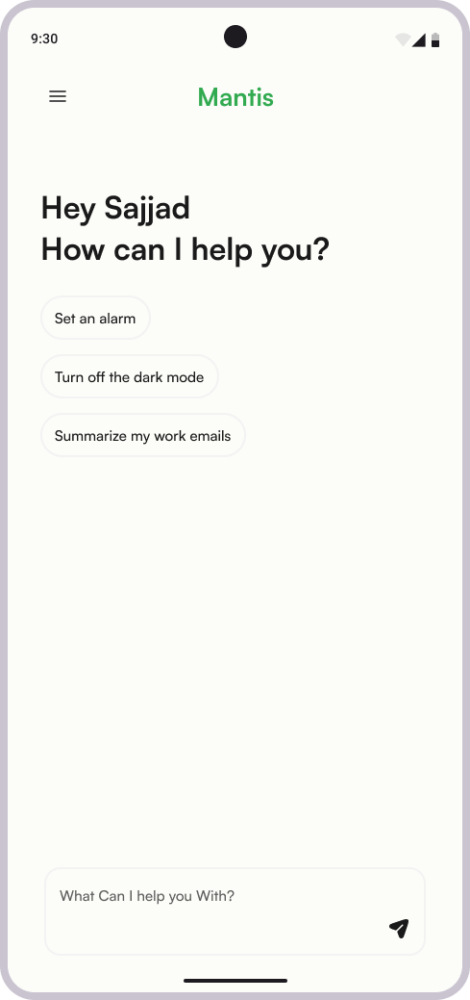
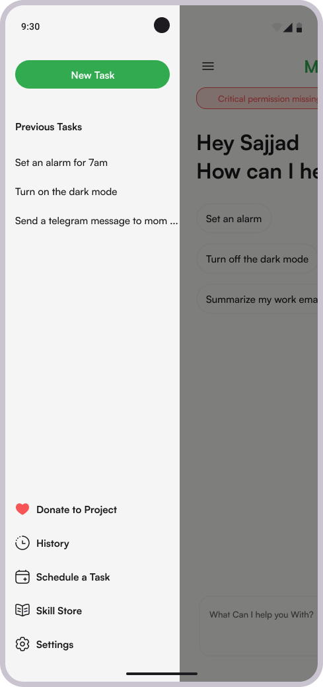

<div align="center">


# MANTIS

### Your phone. Your AI. No cloud.

**MANTIS** is a fully on-device Android AI agent.  
Give it a plain-language task — it takes over your phone, completes it autonomously, and you watch it happen live.

[](https://github.com/sajjad-vahdatzadeh/mantis/releases)
[](https://github.com/sajjad-vahdatzadeh/mantis)
[](LICENSE)
[](https://buymeacoffee.com/mantis.ai)

[**Download APK**](https://github.com/sajjad-vahdatzadeh/mantis/releases/latest) · [**Support the Project**](https://buymeacoffee.com/mantis.ai) · [**Report a Bug**](https://github.com/sajjad-vahdatzadeh/mantis/issues)

</div>

---

## What is MANTIS?

Most "AI assistants" on Android are chatbots. MANTIS is different — it **operates your phone**.


&nbsp;&nbsp;&nbsp;


</div>

You type: *"Send a WhatsApp message to Mom saying I'll be home at 7"*  
MANTIS opens WhatsApp, finds the conversation, types the message, and hits Send.  
You watch every step happen live on screen.

No backend server. No user accounts. No analytics. No data leaves your device except the task you send to your chosen LLM provider.

---

## Features

### Autonomous Agent Loop
MANTIS follows a tight loop: capture screenshot → send to LLM → receive action → execute → repeat. It keeps going until the task is done, it gets stuck, or you take over. Every step is visible on the home screen in real time.

### Full UI Control
Built on Android's Accessibility API, MANTIS can interact with any app on your phone:
- **Tap** any element by index or coordinate
- **Swipe** in any direction
- **Type** text into any input field via a custom IME
- **Scroll** lists and pages
- **Press** Back, Home, and system keys
- **Draw overlays** — numbered bounding boxes over detected UI elements (Set-of-Marks)

### Multi-Provider LLM Support
Choose your AI brain. MANTIS works with:
| Provider | Agent Model | Routing / Cheap Calls |
|---|---|---|
| **Claude** (Anthropic) | claude-sonnet-4-6 | claude-haiku-4-5 |
| **OpenAI** | gpt-4o | gpt-4o-mini |
| **Gemini** (Google) | gemini-2.0-flash | gemini-2.0-flash |
| **Local** | user-selected | same model |

Your API key is stored in Android Keystore — it never appears in plain text, never gets logged, and never goes anywhere except directly to the provider.

### Skills System
Skills are Markdown task templates that guide the agent through common workflows. MANTIS ships with 10 bundled skills:

| Skill | What it does |
|---|---|
| Open App | Launch any app by name |
| Send Message | Compose and send a message in any messaging app |
| Set Alarm | Set an alarm for a specific time |
| Toggle Setting | Turn any system setting on or off |
| Search Web | Open a browser and search for something |
| Take Photo | Open the camera and capture a photo |
| Add Calendar Event | Create a new calendar event |
| Set Reminder | Add a reminder for a specific time |
| Check Battery | Read current battery level and status |
| Enable Wi-Fi | Toggle Wi-Fi on or off |

**Skill Store** — browse and install community skills directly from GitHub. Skills are plain `.md` files anyone can write and share.

### Proactive Scheduler
Set tasks to run automatically on a schedule — no prompting required.
- Daily scheduling at a specific time
- Correct timezone handling (even if you travel)
- Runs silently in the background via WorkManager
- Delivers a notification with the result when done
- Survives device reboots via a boot receiver

### On-Device Memory
MANTIS remembers things about you across sessions. After every completed task, a brief memory entry is appended to a local Markdown file. That file is injected into the system prompt so the agent already knows your name, habits, and preferences without you having to repeat yourself.
- Stored at `/files/memory/user_context.md` — fully readable and editable in Settings
- Auto-summarizes with Haiku when it exceeds 4,000 words
- View, edit, or clear your memory at any time from the Settings screen

### Irreversible Action Confirmation
Before MANTIS executes anything that can't be undone — sending a message, deleting something, making a purchase — it pauses and posts a heads-up notification with **Allow** and **Cancel** buttons. If you don't respond within 60 seconds, it cancels automatically.

### Interrupted Task Resume
Tap **TAKE OVER** to pause the agent mid-task and get your phone back. A persistent notification stays in your drawer. When you're ready, tap **Resume** and MANTIS picks the task back up.

### Task History
Every completed task is saved as a JSON record with outcome, step count, and a summary. Browse the full history in the History screen — sorted newest first.

### Lock Screen
Protect MANTIS with a PIN (PBKDF2+SHA-256) and/or biometric authentication. Locks automatically after 5 minutes in the background.

### Permission Health Monitor
MANTIS monitors its own permission health and surfaces problems clearly:
- **Healthy** — all clear
- **Degraded** — amber banner (agent still runs, some features limited)
- **Broken** — red banner (agent cannot run, tap to fix)

One-tap repair screen with step-by-step instructions tailored to your device manufacturer (Samsung, Xiaomi, Huawei, OnePlus, Oppo, Vivo, and more).

---

## Privacy

| What | Status |
|---|---|
| Backend server | **None** |
| User accounts | **None** |
| Analytics / crash reporting | **None** |
| Data collection | **None** |
| API key storage | Android Keystore (hardware-backed when available) |
| Task history | Local files only, never uploaded |
| Memory | Local files only, never uploaded |

The only data that ever leaves your device is the screenshot and task description sent to your chosen LLM provider, governed by their own privacy policy.

---

## Requirements

- **Android 8.0+** (API 26)
- **Accessibility Service** permission — required for UI control
- **Screen Capture** (MediaProjection) permission — required for screenshots
- **API key** for your chosen LLM provider (Claude, OpenAI, or Gemini)

---

## Getting Started

1. [Download the latest APK](https://github.com/sajjad-vahdatzadeh/mantis/releases/latest) and install it
2. Open MANTIS and complete the 7-screen onboarding:
   - Enter your name
   - Choose your LLM provider and enter your API key
   - Grant Accessibility Service permission
   - Grant Screen Capture permission
   - Grant battery optimization exemption (keeps the agent alive)
   - Set up a PIN lock (optional but recommended)
3. Type any task and tap **Send**

---

## Building from Source

```bash
git clone https://github.com/sajjad-vahdatzadeh/mantis.git
cd mantis
./gradlew assembleDebug
```

Install to a connected device:
```bash
adb install app/build/outputs/apk/debug/app-debug.apk
```

**Requirements:** Android Studio Meerkat or newer, JDK 17+, Android SDK 35.

---

## Support the Project

MANTIS is free, open source, and has no monetization. If it saves you time, consider buying a coffee:

[](https://buymeacoffee.com/mantis.ai)

---

## Attribution

Accessibility layer adapted from [DroidRun](https://github.com/droidrun/droidrun-portal) (MIT).  
Original work Copyright (c) DroidRun contributors.

Files adapted from DroidRun:
- `MantisAccessibilityService.kt`
- `MantisActionExecutor.kt`
- `MantisKeyboardIME.kt`
- `MantisScreenCapture.kt`
- `MantisOverlayService.kt`

---

## License

MIT License — see [LICENSE](LICENSE) for details.
